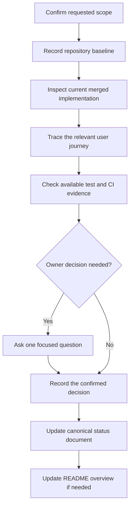

# m.Stock Integration Status and Audit Workflow

**Repository:** `siinghniibandhan-wq/ai-finance-trading-os`  
**Baseline reviewed:** `main` at `64334a6568e8a2672aed0baac18debbcf2b8dfbe`  
**Status record:** 2026-11-13  
**Purpose:** Canonical record of the accepted m.Stock integration scope, owner-confirmed completion, and the workflow used to review and document it.

## 1. Status at a glance

The agreed review scope contains **five steps only**. All five are complete.

| Step | Area | Status | Basis |
|---|---|---|---|
| 1 | Original REST integration | **Complete — owner confirmed** | Owner confirmed all green and instructed that it remain closed. |
| 2 | Broker authentication and session management | **Complete — owner confirmed** | Owner has now explicitly confirmed Step 2 complete. Do not reopen it or require another audit. |
| 3 | BUY/SELL order integration | **Complete — owner confirmed** | Owner confirmed the existing Markets-to-instrument and Portfolio BUY/SELL workflows are complete. |
| 4 | Trade reconciliation and Portfolio | **Complete — owner confirmed** | Owner confirmed that the existing application's implemented reconciliation/Portfolio workflow counts as complete. |
| 5 | Watchlist | **Complete — intentional design accepted** | Device-local persistence is intentional. NSE/BSE quote support, add/remove, duplicate prevention and quote refresh are implemented. Cross-device synchronisation is not required. |

**Scope boundary:** This status document covers Steps 1–5 only. Market Flow/live streaming and any later certification or audit phase are outside this document's agreed scope and are not pending actions.

## 2. Accepted owner decisions

- Existing application functionality is assessed in its real user journey, not as isolated UI/API fragments.
- Steps 1–5 are accepted as complete. Do not reopen them or ask for repeated confirmation unless the owner requests a re-audit or a concrete regression is found.
- The Watchlist is intentionally stored in the current browser/device. Do not treat the absence of cross-device synchronisation as a defect or add cloud persistence without a separate request.
- NSE and BSE quote support is part of the accepted Watchlist implementation.
- A separate backend Watchlist API does not create a requirement to migrate the frontend to it.
- No application code, database, broker configuration, AWS resource, production setting, or deployment may be changed as part of documentation work without separate approval.
- Do not invent additional integration requirements beyond the agreed five steps.

## 3. Five-step integration overview

1. **REST foundation:** market and instrument data access through the original REST integration.
2. **Authentication and sessions:** broker authentication and session-management integration.
3. **Order placement:** BUY/SELL workflows through the supported Markets and Portfolio journeys.
4. **Trade reconciliation and Portfolio:** reconcile broker trade activity with application transactions and portfolio records.
5. **Watchlist:** manage instruments locally on the device, prevent duplicates, and refresh NSE/BSE quotes.

## 4. Documentation and review workflow

Use this process when documenting an agreed change or when the owner requests a re-audit:

1. **Confirm scope.** Identify which of the five accepted steps the request concerns. Do not expand scope implicitly.
2. **Record the baseline.** Capture repository, branch, commit SHA, and review date.
3. **Inspect the current target branch.** Treat merged source as authoritative; distinguish merged changes from open, draft, closed, reverted, or unmerged PRs.
4. **Trace the relevant user journey.** Follow the frontend interaction through its backend/service and persistence boundaries where applicable.
5. **Check evidence accurately.** Distinguish tests that exist from tests actually executed. Record command, environment, result, skips, and CI reference when available.
6. **Classify only genuine findings.** Use: `Complete — owner confirmed`, `Complete — verified in current code`, `Intentional — owner decision`, `Partially implemented`, `Not implemented`, `Cannot verify from this repository`, or `Awaiting owner decision`.
7. **Ask only blocking questions.** Do not ask the owner to reconfirm accepted decisions.
8. **Update the canonical record.** Keep this file as the single source of truth and update the README overview when the documented project workflow or status materially changes.

### Workflow at a glance

## 5. Verification and change-control boundaries

- A test's presence does not prove it was executed or passed.
- A mocked/unit test does not prove live broker connectivity.
- A successful build does not prove production configuration or live broker acceptance.
- Never place a live order as an audit probe.
- Do not enable production flags, change credentials, run migrations, alter AWS resources, or deploy without separate explicit approval.
- Do not claim a test, migration, deployment, or production change succeeded unless its result was directly verified.

## 6. Watchlist decision record

The reviewed frontend stores the Watchlist in browser `localStorage` under `financial-os-market-watchlist`. The Markets UI supports adding and removing instruments, prevents duplicate exchange/symbol entries, and refreshes quotes for supported NSE/BSE instruments using the existing quote API.

This device-local behaviour is intentional and accepted. Cross-device persistence is outside the agreed scope. The backend `/api/watchlist` route is a separate available implementation; its existence does not make frontend adoption mandatory.

## 7. Change log

- **2026-11-13:** Consolidated the five-step integration status and review workflow. Steps 1, 3 and 4 were recorded complete based on prior owner confirmation; Step 5 was recorded complete with device-local persistence as an intentional design decision.
- **2026-11-13:** Owner explicitly confirmed Step 2 complete. Scope is now closed at Steps 1–5; later market-streaming and certification work is excluded from this status record.
