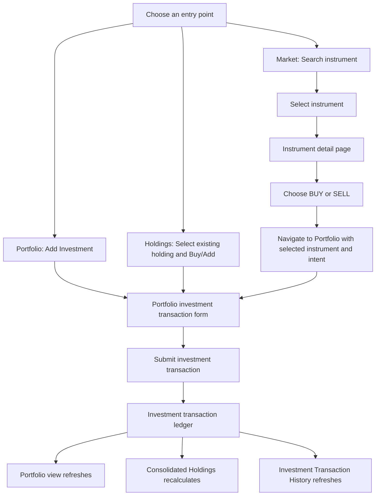
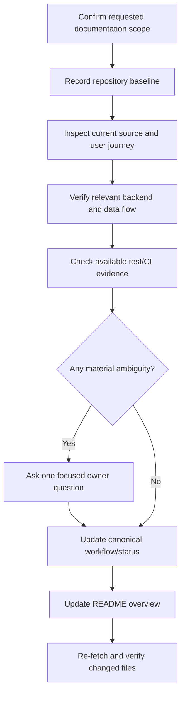

# m.Stock Integration Status and Investment Workflow

**Repository:** `siinghniibandhan-wq/ai-finance-trading-os`  
**Baseline reviewed:** `main` at `64334a6568e8a2672aed0baac18debbcf2b8dfbe`  
**Status record:** 2026-11-13  
**Purpose:** Canonical record of the accepted five-step m.Stock integration scope and the application's Portfolio, Holdings, Market and investment-transaction journeys.

## 1. m.Stock integration status

The agreed integration review contains **five steps only. All five are complete**.

| Step | Area | Status |
|---|---|---|
| 1 | Original REST integration | **Complete — owner confirmed** |
| 2 | Broker authentication and session management | **Complete — owner confirmed** |
| 3 | BUY/SELL order integration | **Complete — owner confirmed** |
| 4 | Trade reconciliation and Portfolio | **Complete — owner confirmed** |
| 5 | Watchlist | **Complete — intentional device-local design accepted** |

This document does not introduce Market Flow/live streaming or any later certification phase into the agreed scope.

## 2. Investment workspace: what each section represents

The four sections serve different purposes and should not be treated as duplicate screens.

| Section | Purpose | What the user sees |
|---|---|---|
| **Portfolio** | Investment-record and portfolio overview | The user's individual investment records, portfolio-level values/performance and the entry point for adding an investment. A record represents an investment position/account entry in the Portfolio workflow. |
| **Holdings** | Consolidated view of positions actually held | Net quantity and valuation for each underlying instrument, consolidated across Portfolio investment records where the instrument identity matches. It derives positions from BUY/SELL investment transactions and retains a legacy-position fallback for older records without ledger activity. |
| **Market** | Discover and inspect instruments | Search instruments, view related matching instruments/results, select one instrument to open its instrument detail page, and initiate BUY or SELL intent from that page. |
| **Transaction History (inside the Invest/Portfolio area)** | Audit trail of investment activity | Individual investment BUY/SELL transactions recorded against Portfolio investments. This is distinct from the general Account/Money transaction history. |

### Portfolio vs Holdings — the important distinction

- **Portfolio is investment-record oriented.** It keeps the individual investment entries and the portfolio-level view.
- **Holdings is instrument-position oriented.** It combines matching instruments across those investment entries and calculates the current net position from the investment transaction ledger.
- For example, if HDFC appears in more than one Portfolio investment record, Holdings can present the combined HDFC position rather than treating each record as a separate underlying instrument.
- Holdings calculations include quantity held, average cost, remaining cost basis, current market value, realised and unrealised gain/loss, total return and broker breakdown where available.
- Older Portfolio entries that pre-date the investment transaction ledger are still represented through the legacy fallback; the system does not fabricate historical transaction rows for them.

**Source reviewed:** `backend/app/routes/holdings.py` describes this consolidated Holdings engine and its ledger/legacy calculation path. `backend/app/routes/investments.py` provides the Portfolio investment-record API. `backend/app/routes/investment_transactions.py` owns the separate investment BUY/SELL ledger.

## 3. Supported ways to buy or sell

The application intentionally provides more than one entry point to the same investment transaction workflow.

### A. Buy from Portfolio

1. Open **Portfolio**.
2. Select **Add Investment**.
3. Enter the investment/instrument and transaction details in the Portfolio investment form.
4. On creation, the initial BUY is recorded as the opening investment transaction.
5. The resulting investment and transaction data feed the Portfolio and Holdings views.

The frontend regression guard checks that creating a new Portfolio investment creates its initial BUY transaction only in create mode; editing an existing investment must not silently create another opening BUY.

### B. Buy or sell from Market

1. Open **Market**.
2. Search for the instrument.
3. Review the related instrument search results.
4. Select the required instrument to open its instrument detail page.
5. Choose **BUY** or **SELL**.
6. The selected action carries the instrument and transaction intent into the Portfolio workflow.
7. The Portfolio section opens and presents the transaction pop-up/form for completion and submission.
8. The transaction is recorded through the investment transaction workflow; the Market instrument page is an entry point, not a separate transaction ledger.

### C. Buy from an existing Holding

1. Open **Holdings**.
2. Locate the existing instrument, for example **HDFC**.
3. Use that holding's **Buy/Add** action.
4. The selected instrument is carried into the Portfolio investment transaction flow.
5. Enter the additional quantity and price/details and submit the BUY.
6. The additional BUY is added to the investment transaction ledger and contributes to the consolidated holding.

This supports adding to an existing position without requiring the user to start again from Market search.

## 4. How updates flow across the application

The investment transaction ledger is the common activity record. Portfolio and Holdings are different views derived from the investment records and transaction activity.

- A BUY or SELL submitted through any supported entry point is recorded as an investment transaction associated with the relevant Portfolio investment.
- Portfolio reflects the investment record and updated portfolio-level values.
- Holdings recalculates the consolidated instrument position from active BUY/SELL investment transactions, including quantity, cost basis and P&L.
- Investment Transaction History displays the individual investment transaction record.
- Market remains the instrument discovery/detail entry point; it does not maintain a separate copy of the user's investment transaction history.

The intended user experience is that a completed investment transaction is reflected across the relevant Portfolio, Holdings and investment-history views after their data refreshes. The views are not separate transaction stores.

### HDFC example

Assume the user already holds HDFC shares:

1. The user can open **Holdings → HDFC → Buy/Add** and record an additional purchase.
2. Alternatively, the user can open **Market**, search HDFC, select the instrument, choose **BUY**, and complete the transaction in the Portfolio pop-up.
3. The user can also use **Portfolio → Add Investment**.
4. Each route records the investment activity through the common investment transaction workflow.
5. Portfolio reflects the investment record; Holdings reflects the updated combined HDFC quantity and valuation; investment Transaction History shows the new BUY entry.

## 5. Investment transaction history vs Account transaction history

There are two different concepts:

- **Investment Transaction History:** BUY/SELL records associated with investment positions. This is the history discussed in this document and is part of the Invest/Portfolio workflow.
- **Account/Money Transaction History:** general cash/account transactions such as income and expenses. It is outside the scope of this investment workflow and must not be used as the reference for Portfolio BUY/SELL history.

The backend keeps the investment ledger in `investment_transactions`, exposed through `backend/app/routes/investment_transactions.py`. The general account transaction system is separate.

## 6. Workflow diagram

## 7. Code evidence reviewed

The following current-`main` files were inspected to ground the workflow description:

- `frontend/src/App.jsx` — main frontend workspace and investment interaction flow.
- `frontend/scripts/theme-audit.mjs` — regression assertions for Market-to-Portfolio intent matching, transaction form duplicate-submit/validation guards, initial BUY creation, and no-holding SELL feedback.
- `backend/app/routes/investments.py` — Portfolio investment records and protection for ledger-controlled positions.
- `backend/app/routes/holdings.py` — consolidated Holdings calculation from BUY/SELL ledger activity, plus legacy-position fallback.
- `backend/app/routes/investment_transactions.py` — separate investment transaction ledger.
- `backend/app/routes/broker_orders.py` and `backend/app/routes/broker_reconciliation.py` — broker order and trade reconciliation boundaries.

The code review establishes the architecture and the documented interaction intent. It is not a claim that a fresh end-to-end live broker transaction was executed during this documentation update.

## 8. Accepted owner decisions and change-control

- Steps 1–5 are accepted as complete. Do not reopen them or ask for repeated confirmation unless the owner requests a re-audit or a concrete regression is found.
- The Watchlist is intentionally stored in the current browser/device. Cross-device persistence is not required.
- NSE/BSE quote support, Watchlist add/remove, duplicate prevention and quote refresh are accepted functionality.
- A separate backend Watchlist API does not create a requirement to migrate the frontend to it.
- Investment Transaction History means the history inside the Invest/Portfolio workflow, not the Account/Money transaction history.
- Preserve the existing multiple entry points for BUY/SELL. They must converge on the common Portfolio investment transaction workflow rather than create separate ledgers.
- No application code, database, broker configuration, AWS resource, production setting, or deployment may be changed as part of documentation work without separate approval.

## 9. Documentation/review workflow

1. Confirm the exact user journey or scope being documented.
2. Record repository, branch, commit SHA and review date.
3. Inspect current merged source first; distinguish merged code from open, draft, closed, reverted or unmerged PRs.
4. Trace the frontend interaction, backend route/service, persistence and derived views.
5. Separate tests that exist from tests actually executed; record actual command, environment, result and CI evidence.
6. Ask only questions that block accurate documentation; do not ask the owner to reconfirm accepted decisions.
7. Update this canonical document and the README overview when the documented workflow materially changes.

### Documentation workflow at a glance

## 10. Verification and safety boundaries

- A test's presence does not prove it was executed or passed.
- A mocked/unit test does not prove live broker connectivity.
- A successful build does not prove production configuration or live broker acceptance.
- Never place a live order as an audit probe.
- Do not enable production flags, change credentials, run migrations, alter AWS resources, or deploy without separate explicit approval.
- Do not claim a test, migration, deployment, or production change succeeded unless its result was directly verified.

## 11. Watchlist decision record

The reviewed frontend stores the Watchlist in browser `localStorage` under `financial-os-market-watchlist`. The Markets UI supports adding and removing instruments, prevents duplicate exchange/symbol entries, and refreshes quotes for supported NSE/BSE instruments using the existing quote API.

This device-local behaviour is intentional and accepted. Cross-device persistence is outside the agreed scope. The backend `/api/watchlist` route is a separate available implementation; its existence does not make frontend adoption mandatory.

## 12. Change log

- **2026-11-13:** Consolidated the five-step integration status and review workflow. Steps 1–5 are recorded complete based on owner confirmation and accepted design decisions.
- **2026-11-13:** Added the Portfolio vs Holdings distinction, Market/Portfolio/Holdings BUY/SELL entry points, shared investment-ledger update flow, investment Transaction History boundary, HDFC example and workflow diagrams based on the owner's explanation and current source review.
