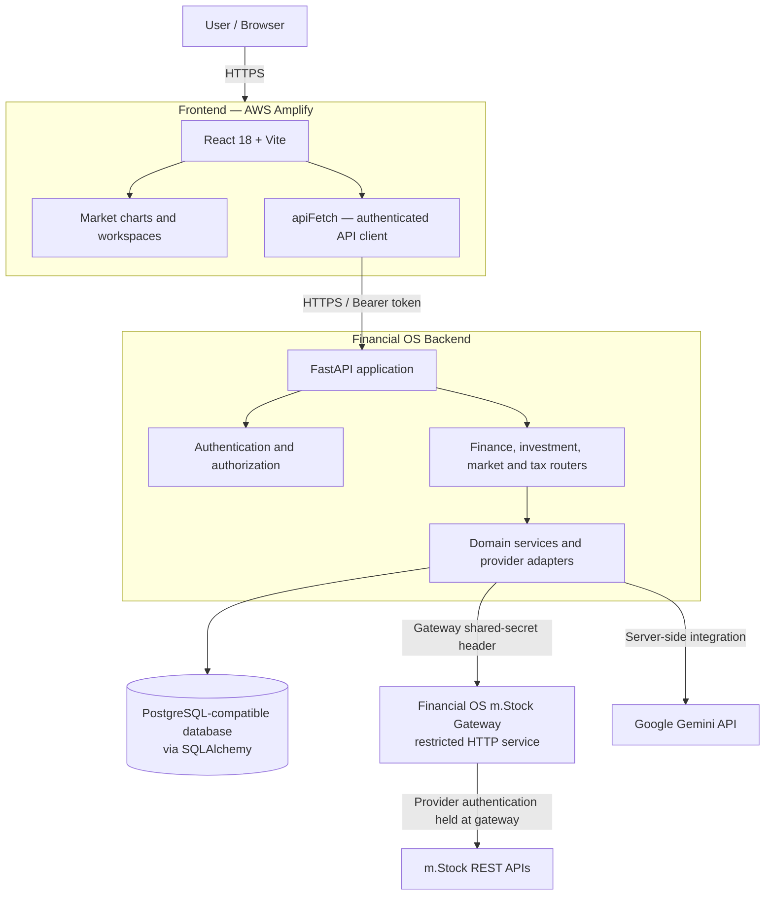
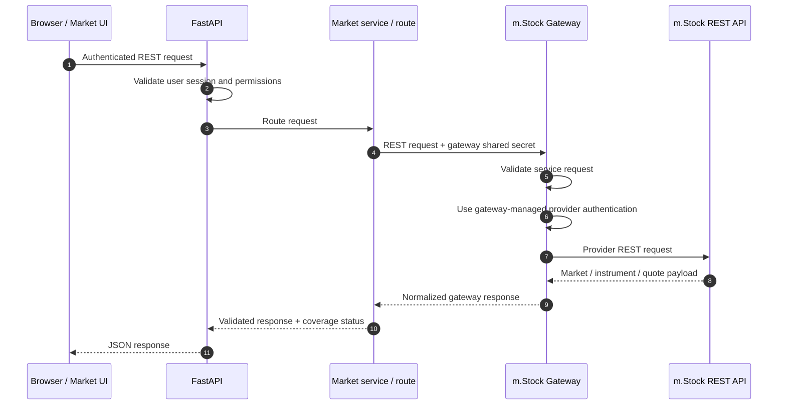
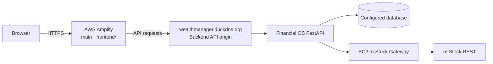

> [!IMPORTANT]
> **Personal-use notice**
> 1. This website and service are intended solely for individual, personal use.
> 2. Displayed plans and pricing are presentation content, not a current commercial offer.
> 3. The application is not currently intended or permitted for commercial use. Any consideration of commercialisation would be no earlier than 3–5 years from now.
> 4. For licensing questions, use the Contact Details section or the contact form.
>
> This notice is displayed on the public homepage, not inside authenticated areas.

<div align="center">

# Financial OS

### Personal Finance · Wealth · Investments · Market Intelligence · Indian Tax

A unified financial workspace built with **React, FastAPI, PostgreSQL-compatible persistence and the m.Stock REST gateway**.

[Architecture](#-architecture) · [Capabilities](#-product-capabilities) · [Getting Started](#-getting-started) · [Operations](#-deployment--operations)

</div>

> [!NOTE]
> **Documentation baseline — 20 November 2026.** This README reflects the repository implementation reviewed on the current `main` branch and the latest user-confirmed resolution of the BSE integration and HTTP 401 authentication incidents. Source implementation, automated test results, deployment state and production verification are treated as separate facts.

---

## ✨ Project at a glance

| Layer | Technology / responsibility |
|---|---|
| Web application | React 18, Vite 6, JavaScript |
| Charts | Lightweight Charts 5 |
| API | FastAPI, Python 3.12, Uvicorn |
| Persistence | SQLAlchemy 2, PostgreSQL driver |
| Market provider | m.Stock REST API through the Financial OS gateway |
| AI | Google Gemini integration |
| Frontend hosting target | AWS Amplify — `main`, app root `frontend/` |
| Backend API origin | `https://wealthmanager.duckdns.org` |
| CI | GitHub Actions — build, regression tests, dependency audits and secret scan |

### Current engineering snapshot

<details>
<summary><strong>Market & authentication updates — 20 November 2026</strong></summary>

- **BSE integration issue — resolved:** BSE exchange support is present in the market-data path. BSE cash-market movers are requested separately from NSE; BSE is also accepted by the Options Hub and exchange-aware quote/search paths.
- **NSE/BSE derivatives discovery — verified in the 19 November test session:** the gateway returned NSE Futures **685**, NSE Options **92,283**, BSE Futures **661**, and BSE Options **45,318** contracts (combined observed discovery count **138,947**). These are observed master-discovery counts, not permanent instrument totals.
- **Derivatives quotes:** REST LTP retrieval was tested for NSE/BSE futures and options. Optional fields such as volume and open interest remain subject to actual provider coverage; unavailable fields must stay unavailable rather than being fabricated.
- **HTTP 401 authentication incident — resolved per latest user verification:** the post-OTP `401 Authentication is required` issue is no longer a reported active blocker. Preserve the existing OTP/authentication flow and gateway-owned provider session; do not add a parallel login or token mechanism.
- **Market Flow transport:** REST only. No WebSocket or continuous exchange-tick stream is part of the current Chart Flow / Advanced Chart implementation.

</details>

> **Status discipline:** “Resolved” reflects the latest user confirmation. It does not replace a recorded CI run or a production smoke-test record. Do not claim a deployment is live unless its deployment record has been checked.

---

## 🧭 Product capabilities

| Domain | Main capabilities |
|---|---|
| **Personal finance** | Dashboard, Wealth Manager, accounts, transactions, ledger, chart of accounts, categories, bills, loans/liabilities, budgets, goals and Finance Diary |
| **Investments** | Portfolio, holdings, investment transactions, P&L, watchlists and broker reconciliation |
| **Market intelligence** | Market overview, quotes, instrument search, indices, movers, historical OHLCV, Chart Flow, Advanced Chart and Options Hub |
| **Indian tax workspace** | Income aggregation, deductions/exempt income, capital gains, house property, business income, loss set-off, tax liability and ITR-ready reporting |
| **AI & administration** | Gemini-powered AI Assistant, profile/settings and admin-only operations |
| **Experience** | Central theme system and responsive application navigation |

This is a repository capability map. Each workflow still has its own integration, test and production-verification status.

---

## 🏗️ Architecture

### System context



### Market-data request path



### Authentication boundaries

- The browser authenticates to Financial OS APIs using the application's Bearer access-token flow.
- The backend authenticates service-to-service requests to the m.Stock gateway with the configured gateway shared secret.
- m.Stock provider credentials, OTP/TOTP and provider access-token handling remain inside the gateway.
- The browser must never receive provider credentials, gateway secrets, database credentials or AWS secrets.
- The latest post-OTP HTTP 401 incident is user-confirmed resolved. Keep the existing authentication design; do not add a second authentication mechanism as a workaround.

### Market data: REST-first design

| Workspace / API | Current role | Important boundary |
|---|---|---|
| Market Overview | Index and market-mover snapshots | Partial provider responses are surfaced |
| Quotes | Latest instrument/index quote | Snapshot, not an exchange tick |
| Instrument Search | Gateway instrument-master search | Exchange-aware NSE/BSE symbols |
| Market Indices | Benchmark/index snapshots | Individual provider availability may vary |
| Market Movers | Provider-ranked gainers and losers | Not a complete exchange breadth feed |
| Chart Flow | Cash-market mover distribution and selected-sector views | Read-only, bounded REST calls |
| Advanced Chart | Historical OHLCV candles and quote snapshots | No synthetic candles or WebSocket feed |
| Options Hub | Derivatives master, option-chain contracts and quote coverage | Actual provider fields only; partial data is explicit |

**NSE and BSE coverage**
- Chart Flow requests NSE and BSE cash-market movers using the provider's exchange/segment mapping.
- Options Hub accepts both `NSE` and `BSE` for derivatives master and chain requests.
- The 19 November discovery test returned 138,947 contracts across the four NSE/BSE futures/options groups listed above.
- LTP availability does not imply that volume, OI, Greeks or every option-chain field is available. The UI/API must label unsupported or missing fields honestly.

**Chart Flow data limitations**
- Provider-ranked gainers/losers are samples of top movers, not every listed security.
- Sector mover lists are provider-ranked lists, not complete sector constituents.
- Full advance/decline breadth, delivery statistics and historical market-flow series are not implied by the current mover endpoint.
- Quote retrieval time is not the exchange's original tick timestamp.
- Refreshes are bounded REST requests; the current Chart Flow/Advanced Chart path does not use WebSockets or continuous streaming.

---

## 🧩 Repository structure

```text
.
├── .github/
│   └── workflows/
│       ├── financial-os-ci.yml
│       ├── frontend-build.yml
│       └── package-aws-restored-source.yml
├── backend/
│   ├── app/
│   │   ├── database/       # SQLAlchemy engine and sessions
│   │   ├── routes/         # FastAPI routers
│   │   ├── services/       # Domain and provider integrations
│   │   ├── main.py         # Application composition / router registration
│   │   └── models.py       # Persistence models
│   ├── migrations/         # SQL migration files
│   ├── tests/
│   ├── .env.example
│   ├── requirements.txt
│   └── requirements-dev.txt
├── frontend/
│   ├── src/
│   │   ├── features/
│   │   │   ├── advanced-chart/
│   │   │   ├── order-flow/
│   │   │   └── options-hub/
│   │   ├── main.jsx
│   │   ├── App.jsx
│   │   └── api.js
│   ├── scripts/
│   └── package.json
├── docs/
│   ├── specs/
│   └── ... engineering notes and phase audits
├── AUDIT_REPORT.md
├── SECURITY_OPERATIONS.md
├── THEME_SYSTEM_REDESIGN.md
└── README.md
```

The tree is intentionally high-level; use the source files for the complete inventory.

---

## 🚀 Getting started

### Prerequisites

- Node.js 20
- Python 3.12
- PostgreSQL-compatible database for backend workflows
- Valid development-only credentials for any external integration being tested

### Frontend

```bash
cd frontend
npm install
npm run dev
```

Production build:

```bash
npm run build
```

### Backend

```bash
cd backend
python3.12 -m venv .venv
source .venv/bin/activate
python -m pip install -r requirements.txt -r requirements-dev.txt
cp .env.example .env
uvicorn app.main:app --reload
```

Set valid local values in `.env` before starting the API. Never use production credentials for local development.

---

## ⚙️ Configuration

Use [`backend/.env.example`](backend/.env.example) as the variable-name reference. Common configuration groups include:

| Variable / group | Purpose |
|---|---|
| `DATABASE_URL` | Database connection |
| `AUTH_SECRET_KEY` | Application access-token signing |
| `ADMIN_USER_ID` | Configured administrator identity |
| `APP_ENV` | Runtime environment |
| `CORS_ALLOWED_ORIGINS` | Exact allowed browser origins |
| `TRUSTED_PROXY_COUNT` | Explicit trusted reverse-proxy chain |
| `MSTOCK_GATEWAY_URL` | Backend-to-gateway URL |
| `MSTOCK_GATEWAY_SECRET` | Backend-to-gateway shared secret |
| Gemini / AI settings | Server-side AI provider configuration |
| AWS role / SSM settings | Server-side secret retrieval where configured |

> [!CAUTION]
> Never commit a real `.env`, API key, broker credential, provider access token, OTP/TOTP seed, private key or gateway shared secret. Never expose them through `VITE_*` variables, browser bundles, logs or screenshots. Prefer instance roles and managed secret storage over static AWS credentials.

---

## 🧪 Testing and quality gates

The main workflow is [`.github/workflows/financial-os-ci.yml`](.github/workflows/financial-os-ci.yml). It runs on pushes and pull requests targeting `main`, plus manual dispatch.

| CI job | Checks |
|---|---|
| Frontend | Notice schedule, sidebar, market overview, Advanced Chart, Order Flow, Options Hub, production build, security regression guard and npm audit |
| Backend | Python 3.12, dependency installation, pip-audit and pytest |
| Secrets | Gitleaks repository-history scan |

### Run checks locally

```bash
# Frontend
cd frontend
npm install
npm run test:notice
npm run test:sidebar
npm run test:market
npm run test:advanced-chart
npm run test:order-flow
npm run test:options-hub
npm run test:security
npm run build
npm audit --audit-level=high

# Backend (from backend/)
python -m pip install -r requirements.txt -r requirements-dev.txt
PYTHONPATH=. pytest -q
```

A passing workflow is evidence only for the exact commit and checks that ran. It does not independently prove a production deployment, live AWS health, provider uptime or broker-order safety.

---

## ☁️ Deployment & operations

### Hosting boundary



- **Frontend target:** AWS Amplify, `main` branch, monorepo app root `frontend/`, build command `npm run build`, output `dist`.
- **API origin:** `https://wealthmanager.duckdns.org`. DuckDNS is the API origin, not the public frontend host.
- **Gateway:** recorded EC2-hosted Flask service, `mstock-gateway.service`, loopback listener `127.0.0.1:8000`.
- **Backend service:** recorded as `financial-os-backend.service`, Gunicorn with two workers on `127.0.0.1:8001`.
- **Historical gateway host record:** `ap-southeast-2` (Sydney). Confirm live AWS inventory before any operational action.
- **Deployment verification:** check the actual Amplify deployment ID and commit before describing a commit as production-deployed. EC2/Nginx static frontend retirement remains a separate host-side verification.

### CI and release sequence

1. Open and review the intended pull request.
2. Confirm required CI checks pass on the exact commit.
3. Merge to the intended branch.
4. Verify the hosting provider's deployment record.
5. Apply any approved database migration separately, with a verified backup and recovery plan.
6. Run safe smoke tests: frontend loading, login/session continuity, account and transaction reads, market REST, BSE/NSE data paths and gateway connectivity.
7. Record commit SHA, CI run, deployment ID, environment and smoke-test outcome.

The source-archive workflow creates an artifact; it is not an EC2 deployment or service restart. CI artifact creation is not proof of Amplify deployment.

---

## 🗃️ Database governance

The repository contains SQL migration files and backend startup schema/table logic. The reviewed source does not establish a single verified migration runner, migration ledger, scheduled schema-application service or automatic production migration workflow.

- Do not assume a committed SQL file is automatically applied.
- Do not run production schema changes without explicit approval.
- Preserve unique, immutable migration identifiers.
- Back up and verify restore capability before production migrations.
- Keep schema changes separate from application, service and deployment changes.
- Startup `create_all` and ad-hoc conditional ALTER logic are not a substitute for controlled migration history.

A controlled migration framework, checksum ledger, dry-run/status modes, backup gate, failure handling and scheduling remain governance work until implemented and verified.

---

## 🔐 Security & financial safety

- Enforce authentication, authorization and user-data ownership on protected APIs.
- Keep application signing secrets and provider credentials server-side.
- Keep the gateway listener private/restricted; do not expose ports 8000 or 8001 directly to the public internet.
- Preserve the gateway shared-secret boundary.
- Broker execution is high risk: retain admin restrictions, gateway safeguards and the kill switch. Never place a live test order as part of routine CI.
- Treat tax and investment calculations as decision-support outputs requiring review against current Indian law and source evidence.
- Never treat an AI-generated tax or investment response as a substitute for professional review.

See [`SECURITY_OPERATIONS.md`](SECURITY_OPERATIONS.md) for infrastructure boundaries, secrets, database controls, incident history and operational checklists.

---

## 🗺️ Delivery status & roadmap

| Area | Current documented state |
|---|---|
| Financial modules | Core finance, investment and tax routes/UI are present; workflow maturity varies by module |
| Market REST integration | Implemented through the existing m.Stock gateway |
| NSE/BSE cash movers | Implemented in Market Flow with provider-ranked coverage |
| NSE/BSE derivatives discovery | Master discovery tested; observed 19 Nov counts recorded above |
| Derivatives quotes | LTP requests tested; optional field coverage remains provider-dependent |
| Options Hub | REST adapter and partial quote handling implemented |
| Chart Flow / Advanced Chart | REST-only implementation; no continuous streaming |
| Post-OTP HTTP 401 incident | Resolved per latest user verification; retain current auth flow |
| AWS deployment | Amplify frontend target recorded; live commit/deployment verification remains operational |
| Database migration governance | Unified controlled runner/ledger not verified in repository |

### Priority engineering work

1. **Release assurance:** record CI and production smoke-test evidence for each release.
2. **Infrastructure truth:** verify live AWS resources, network boundaries, database hosting, backups, monitoring and recovery.
3. **Database governance:** implement a controlled migration runner and immutable migration ledger.
4. **Market data quality:** expand provider-coverage tests while preserving honest partial-data semantics.
5. **Security lifecycle:** continue session, recovery and browser-security review without introducing a parallel authentication path.

---

## 📚 Documentation map

| Document | Purpose |
|---|---|
| [AUDIT_REPORT.md](AUDIT_REPORT.md) | Product inventory, implementation status, gaps and roadmap |
| [SECURITY_OPERATIONS.md](SECURITY_OPERATIONS.md) | AWS architecture, secrets, network boundaries, operations and incident history |
| [THEME_SYSTEM_REDESIGN.md](THEME_SYSTEM_REDESIGN.md) | Theme-system design and visual implementation notes |
| [docs/](docs/) | Engineering specifications, phase audits and implementation records |

---

<div align="center">

**Financial OS** · Built for disciplined personal-finance and market-data workflows.

<sub>Keep documentation aligned with code. Keep secrets out of source. Verify before deploying.</sub>

</div>
